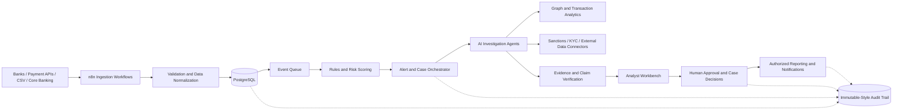
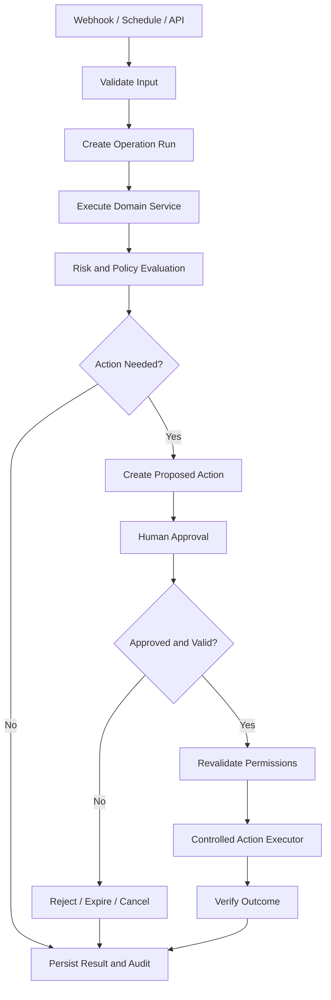
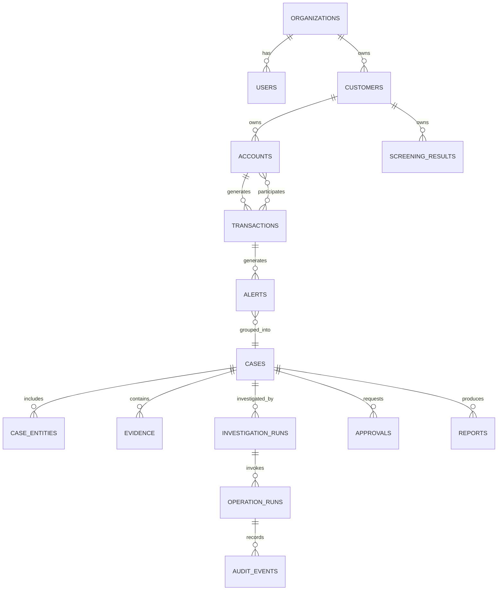
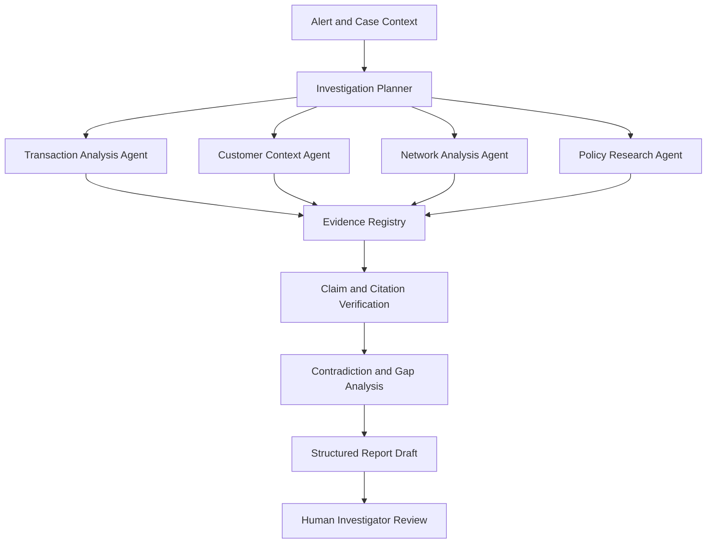

# Enterprise AI Financial Crime Investigation Platform

Commercial product blueprint · 150+ automation operations · n8n + AI agents + Python + PostgreSQL

Let's design this as a commercial, enterprise-ready Financial Crime Investigation Platform rather than a collection of standalone n8n workflows.

The system will help banks, fintech companies, payment processors and compliance teams ingest financial data, detect suspicious activity, investigate cases, assemble evidence, manage analyst reviews and generate auditable reports.

The goal is to create one product with a shared engine and 150+ defined operations across 15 modules. Each operation will have a stable ID, trigger, input/output contract, risk policy, audit trail and test requirements.

Important distinction: a large operation catalog alone does not make software ready for sale. Commercial readiness also requires reliable integrations, access controls, tenant isolation, security testing, deployment documentation, support procedures and validation against realistic data.

## 1. Product architecture

### Financial Crime Intelligence Engine

One product · 15 modules · 150+ operations · Centralized governance

| 150+ | 15 | 1 |
| --- | --- | --- |
| Operations | Modules | Platform |

### Target customers

- Banks and digital banks
- Fintech and payment service providers
- Money service businesses
- Compliance and financial-crime investigation teams
- AML consulting firms and managed compliance service providers
- Enterprise fraud and risk operations teams

### What customers buy

- Automated alert intake and triage
- Transaction monitoring and fraud investigation workflows
- Customer and counterparty risk analysis
- Sanctions and watchlist screening integrations
- AI-assisted investigations with traceable evidence
- Case management, approvals and audit reporting
- Deployment options, integration packs and ongoing support

This should be positioned as an investigation and decision-support platform, not a system that autonomously declares someone guilty or guarantees regulatory compliance.

## 2. Enterprise system architecture



### Technology stack

| Layer                             | Technology                                                          |
| --------------------------------- | ------------------------------------------------------------------- |
| Workflow orchestration            | n8n                                                                 |
| Business APIs                     | Python + FastAPI                                                    |
| Risk and analytics                | Python, pandas, scikit-learn                                        |
| AI agents                         | LLM APIs or self-hosted models; LangGraph where useful              |
| Main database                     | PostgreSQL                                                          |
| Semantic retrieval                | pgvector                                                            |
| Transaction relationship analysis | PostgreSQL initially; graph database if justified                   |
| Queueing                          | Redis or a dedicated durable message broker                         |
| Frontend                          | Next.js + TypeScript                                                |
| Identity                          | OIDC-compatible identity provider and RBAC                          |
| Observability                     | OpenTelemetry-compatible traces, structured logs and metrics        |
| Deployment                        | Docker Compose locally; hardened container deployment for customers |
| Testing                           | pytest, integration tests, workflow tests and AI evaluations        |

n8n coordinates the work. The backend owns the risk rules, data integrity, permissions, case state and authorization. AI proposes explanations and investigative leads; it does not bypass the policy engine.

## 3. The complete 150-operation catalog

The platform will have 15 modules, each containing 10 distinct operations. These are the planned capabilities; each must be implemented and tested before being advertised as available to customers.

### Module 1 — Data ingestion and normalization

Operations 001–010 · Establish trustworthy, traceable financial data

| ID        | Operation                       | Trigger and expected result                                             |
| --------- | ------------------------------- | ----------------------------------------------------------------------- |
| `ING-001` | Transaction file ingestion      | CSV/XLSX upload → register batch and source                             |
| `ING-002` | Payment API ingestion           | Webhook/API event → persist incoming event                              |
| `ING-003` | Core banking data sync          | Scheduled sync → retrieve authorized incremental records                |
| `ING-004` | Schema validation               | New batch → validate fields, types and required columns                 |
| `ING-005` | Data normalization              | Valid record → normalize dates, currency and identifiers                |
| `ING-006` | Duplicate transaction detection | Record received → detect duplicate source IDs or fingerprints           |
| `ING-007` | Data quality scoring            | Batch validated → calculate completeness and quality metrics            |
| `ING-008` | Invalid record quarantine       | Validation failure → isolate record with reason                         |
| `ING-009` | Batch reconciliation            | Import completed → compare source and accepted record counts and totals |
| `ING-010` | Ingestion audit reporting       | Batch finished → generate traceable import report                       |

### Module 2 — Transaction monitoring and detection

Operations 011–020 · Detect patterns requiring investigation

| ID        | Operation                           | Trigger and expected result                                           |
| --------- | ----------------------------------- | --------------------------------------------------------------------- |
| `MON-011` | Transaction threshold monitoring    | Transaction received → evaluate configured amount thresholds          |
| `MON-012` | Transaction velocity detection      | Activity window updated → flag unusual transaction frequency          |
| `MON-013` | Structuring-pattern detection       | Rolling activity window → flag possible transaction splitting         |
| `MON-014` | Rapid fund movement detection       | Linked transfers observed → flag rapid movement of funds              |
| `MON-015` | Unusual geographic activity         | Location pattern changes → flag unusual geographic combinations       |
| `MON-016` | Dormant account reactivation        | Dormant account transacts → flag activity for review                  |
| `MON-017` | Unusual transaction timing          | Transaction received → compare against configured historical patterns |
| `MON-018` | Counterparty concentration analysis | Analysis window closes → identify concentration changes               |
| `MON-019` | Round-amount pattern detection      | Transaction stream updated → flag configurable round-amount patterns  |
| `MON-020` | Monitoring rule evaluation          | Transaction or scheduled batch → evaluate versioned detection rules   |

Detection signals are indicators for investigation, not proof of wrongdoing. Rules should be configurable, tested against labeled data and monitored for false positives.

### Module 3 — Fraud detection and payment abuse

Operations 021–030 · Identify potentially fraudulent payment activity

| ID        | Operation                         | Trigger and expected result                                          |
| --------- | --------------------------------- | -------------------------------------------------------------------- |
| `FRD-021` | Duplicate payment detection       | Payment submitted → flag repeated payment references                 |
| `FRD-022` | Account takeover signal detection | Authentication and payment events → combine approved risk indicators |
| `FRD-023` | Device and session risk analysis  | Session event → evaluate permitted device and session signals        |
| `FRD-024` | Payment velocity scoring          | Payment activity updated → calculate rule-based velocity score       |
| `FRD-025` | Beneficiary change monitoring     | Beneficiary changes → create review signal                           |
| `FRD-026` | Unusual refund detection          | Refund created → compare against transaction history and policy      |
| `FRD-027` | Chargeback pattern analysis       | Chargeback received → link related transactions and cases            |
| `FRD-028` | Merchant anomaly detection        | Merchant metrics refreshed → flag unusual behavioral changes         |
| `FRD-029` | Fraud model scoring               | Eligible event → return model score, version and reason codes        |
| `FRD-030` | Fraud alert prioritization        | Signals combined → rank alerts using approved rules and evidence     |

### Module 4 — Customer due diligence and KYC

Operations 031–040 · Customer identity, risk profiles and due diligence

| ID        | Operation                        | Trigger and expected result                                      |
| --------- | -------------------------------- | ---------------------------------------------------------------- |
| `KYC-031` | Customer profile ingestion       | Authorized customer record → create or update normalized profile |
| `KYC-032` | Identity document extraction     | Document uploaded → extract fields and confidence values         |
| `KYC-033` | Identity field consistency check | Documents received → identify mismatched fields                  |
| `KYC-034` | Customer deduplication           | New profile → find candidate duplicate identities                |
| `KYC-035` | Beneficial ownership mapping     | Ownership data received → construct an ownership chain           |
| `KYC-036` | Customer risk scoring            | Profile updated → calculate explainable risk indicators          |
| `KYC-037` | KYC completeness monitoring      | Scheduled scan → identify missing or expired required records    |
| `KYC-038` | Enhanced due diligence routing   | Configured risk criteria met → route case for enhanced review    |
| `KYC-039` | Periodic KYC review scheduling   | Review due date approaches → create review task                  |
| `KYC-040` | Customer risk profile summary    | Profile or evidence changes → prepare sourced analyst summary    |

Identity extraction and matching must preserve uncertainty. Possible matches should be reviewed by qualified personnel instead of automatically merging records or rejecting customers.

### Module 5 — Sanctions and watchlist screening

Operations 041–050 · Integrate authorized screening sources

| ID        | Operation                          | Trigger and expected result                                                   |
| --------- | ---------------------------------- | ----------------------------------------------------------------------------- |
| `SAN-041` | Watchlist data ingestion           | Authorized list updated → store source and version metadata                   |
| `SAN-042` | Watchlist freshness monitoring     | Scheduled check → detect stale screening data                                 |
| `SAN-043` | Customer name screening            | Customer created or updated → retrieve potential matches                      |
| `SAN-044` | Counterparty screening             | Payment counterparty received → screen against configured lists               |
| `SAN-045` | Fuzzy name matching                | Candidate names compared → calculate match features                           |
| `SAN-046` | Alias and transliteration matching | Name variations supplied → identify additional candidates                     |
| `SAN-047` | Match evidence compilation         | Potential match found → assemble matching and conflicting attributes          |
| `SAN-048` | Screening alert deduplication      | New candidate match → link to existing open review where appropriate          |
| `SAN-049` | Potential match review routing     | Candidate match created → assign authorized reviewer                          |
| `SAN-050` | Screening decision audit           | Reviewer records decision → preserve rationale, source version and timestamps |

Screening requires licensed or otherwise authorized data sources where applicable. Name similarity alone must never be treated as a confirmed sanctions match.

### Module 6 — Customer and counterparty network intelligence

Operations 051–060 · Investigate relationships between entities and accounts

| ID        | Operation                        | Trigger and expected result                                                  |
| --------- | -------------------------------- | ---------------------------------------------------------------------------- |
| `NET-051` | Entity resolution                | Related records arrive → propose possible entity links                       |
| `NET-052` | Account relationship mapping     | Ownership or transfer link recorded → update relationship graph              |
| `NET-053` | Shared identifier analysis       | Identifier reused → identify associated records for review                   |
| `NET-054` | Transaction chain reconstruction | Investigation opened → reconstruct traceable fund-flow paths                 |
| `NET-055` | Multi-hop relationship search    | Analyst queries entity → retrieve connected entities within configured depth |
| `NET-056` | Circular flow detection          | Transaction graph updated → identify possible circular movement              |
| `NET-057` | Common counterparty analysis     | Graph refreshed → find shared counterparties                                 |
| `NET-058` | Network concentration analysis   | Analysis window closes → measure concentration and connectivity              |
| `NET-059` | Relationship timeline generation | Investigation requested → build a dated relationship timeline                |
| `NET-060` | Graph evidence export            | Analyst requests export → produce access-controlled relationship evidence    |

### Module 7 — AML case management

Operations 061–070 · Turn alerts into traceable investigations

| ID        | Operation                          | Trigger and expected result                                          |
| --------- | ---------------------------------- | -------------------------------------------------------------------- |
| `CAS-061` | Alert-to-case creation             | Qualifying alert → create case with source references                |
| `CAS-062` | Case deduplication                 | New alert arrives → detect candidate duplicate or related case       |
| `CAS-063` | Case priority calculation          | Case created or updated → calculate policy-based priority            |
| `CAS-064` | Case assignment                    | Case ready → assign according to queue, skill and permissions        |
| `CAS-065` | Investigation checklist generation | Case opened → create a checklist from approved templates             |
| `CAS-066` | Case SLA monitoring                | Case ages → flag overdue milestones                                  |
| `CAS-067` | Evidence request management        | Evidence missing → create task or request through authorized channel |
| `CAS-068` | Case status synchronization        | Authorized status change → synchronize permitted connected systems   |
| `CAS-069` | Case escalation routing            | Escalation policy met → route to supervisor or specialist            |
| `CAS-070` | Case closure validation            | Closure requested → verify mandatory fields and review completion    |

### Module 8 — AI investigation agents

Operations 071–080 · Use specialist agents for evidence-based investigative assistance

| ID        | Operation                          | Trigger and expected result                                              |
| --------- | ---------------------------------- | ------------------------------------------------------------------------ |
| `AGT-071` | Investigation coordinator          | Case meets criteria → create bounded investigation plan                  |
| `AGT-072` | Transaction analysis agent         | Transaction set supplied → summarize patterns and anomalies              |
| `AGT-073` | Customer context agent             | Case requires context → assemble authorized customer facts               |
| `AGT-074` | Network analysis agent             | Relationship graph available → identify paths and associations           |
| `AGT-075` | Policy research agent              | Investigation question received → retrieve applicable policy passages    |
| `AGT-076` | Timeline reconstruction agent      | Evidence collected → produce a sourced event chronology                  |
| `AGT-077` | Contradiction detection agent      | Findings assembled → flag conflicting or inconsistent evidence           |
| `AGT-078` | Missing evidence agent             | Investigation plan evaluated → identify unresolved evidence gaps         |
| `AGT-079` | Investigator report drafting agent | Evidence validated → draft structured investigation report               |
| `AGT-080` | Agent result verification          | Agent outputs received → validate schemas, citations and factual support |

Each agent must have a defined scope, allowed tools, token and time budgets, structured outputs, and an evaluation suite. Agents should not be granted unrestricted access to databases or external systems.

### Module 9 — Evidence management and reporting

Operations 081–090 · Maintain traceable, reviewable investigation evidence

| ID        | Operation                       | Trigger and expected result                                          |
| --------- | ------------------------------- | -------------------------------------------------------------------- |
| `EVD-081` | Evidence registration           | Evidence received → assign ID, source and metadata                   |
| `EVD-082` | Evidence integrity hashing      | Evidence stored → calculate cryptographic digest                     |
| `EVD-083` | Evidence provenance tracking    | Evidence transformed → record source and transformation history      |
| `EVD-084` | Evidence-to-claim linking       | Report claim created → associate supporting or conflicting evidence  |
| `EVD-085` | Citation verification           | Report drafted → verify references resolve to authorized evidence    |
| `EVD-086` | Evidence gap reporting          | Case reviewed → list missing items and unresolved questions          |
| `EVD-087` | Investigation report generation | Case reaches reporting stage → generate a structured report draft    |
| `EVD-088` | Report quality validation       | Report drafted → check required sections, references and consistency |
| `EVD-089` | Evidence bundle export          | Authorized export requested → create a manifest and evidence package |
| `EVD-090` | Report version management       | Report revised → preserve version history and reviewer decisions     |

Cryptographic hashing helps detect changes but does not by itself prove authenticity or make a record legally admissible. Production evidence storage also needs access controls, retention policies and tamper-evident logging.

### Module 10 — Risk scoring and decision support

Operations 091–100 · Make investigative prioritization explainable

| ID        | Operation                           | Trigger and expected result                                                      |
| --------- | ----------------------------------- | -------------------------------------------------------------------------------- |
| `RSK-091` | Customer risk indicator calculation | Profile updated → calculate configured indicators                                |
| `RSK-092` | Transaction risk scoring            | Eligible transaction → calculate versioned risk score                            |
| `RSK-093` | Alert risk aggregation              | Multiple signals received → combine indicators using approved rules              |
| `RSK-094` | Risk score explanation              | Score generated → list contributing factors and their sources                    |
| `RSK-095` | Risk threshold monitoring           | Score changes → determine whether configured review threshold is crossed         |
| `RSK-096` | False-positive feedback capture     | Analyst reviews alert → record structured feedback                               |
| `RSK-097` | Threshold sensitivity analysis      | Evaluation run requested → compare outcomes at alternative thresholds            |
| `RSK-098` | Model drift monitoring              | New production data available → compare feature and score distributions          |
| `RSK-099` | Risk model performance evaluation   | Labeled outcomes available → calculate precision, recall and calibration metrics |
| `RSK-100` | Model version promotion review      | Candidate model passes evaluation → prepare a review package for approval        |

Model outputs should support prioritization, not automatically determine guilt, regulatory reporting or customer account closure. Model promotion requires validation, documented limitations and authorized approval.

### Module 11 — Regulatory compliance operations

Operations 101–110 · Assist compliance teams with controlled, jurisdiction-aware processes

| ID        | Operation                         | Trigger and expected result                                    |
| --------- | --------------------------------- | -------------------------------------------------------------- |
| `CMP-101` | Regulatory source ingestion       | Approved source updated → register source and effective date   |
| `CMP-102` | Regulatory change detection       | New publication available → flag potentially relevant changes  |
| `CMP-103` | Obligation mapping                | Change reviewed → map requirements to configured controls      |
| `CMP-104` | Policy-to-control mapping         | Policy version updated → identify linked controls and gaps     |
| `CMP-105` | Control evidence collection       | Audit scheduled → gather authorized evidence references        |
| `CMP-106` | Compliance checklist generation   | Review initiated → create jurisdiction-specific checklist      |
| `CMP-107` | Reporting deadline monitoring     | Deadline approaches → alert responsible compliance owner       |
| `CMP-108` | Regulatory report preparation     | Authorized case reaches reporting stage → prepare report draft |
| `CMP-109` | Regulatory submission approval    | Draft finalized → route to designated authorized approver      |
| `CMP-110` | Submission receipt reconciliation | Submission attempted → record receipt, status and reference    |

Regulatory rules must be configured for the customer's jurisdiction and reviewed by qualified compliance personnel. The platform should not claim that AI-generated reports are automatically compliant or ready to submit without review.

### Module 12 — Human review and approvals

Operations 111–120 · Keep consequential decisions under accountable human control

| ID        | Operation                         | Trigger and expected result                                       |
| --------- | --------------------------------- | ----------------------------------------------------------------- |
| `APR-111` | Approval request creation         | Action requires approval → create a versioned request             |
| `APR-112` | Reviewer assignment               | Request created → select an authorized reviewer                   |
| `APR-113` | Approval deadline monitoring      | Request pending → detect approaching deadlines                    |
| `APR-114` | Approval notification             | Request assigned → notify reviewer through configured channel     |
| `APR-115` | Approval payload verification     | Reviewer opens request → display exact action and evidence        |
| `APR-116` | Segregation-of-duties enforcement | Decision submitted → enforce reviewer independence where required |
| `APR-117` | Approval decision recording       | Reviewer decides → persist decision, actor and rationale          |
| `APR-118` | Approval expiry handling          | Deadline passes → expire request and block execution              |
| `APR-119` | Approval revocation handling      | Approval invalidated → prevent execution and record reason        |
| `APR-120` | Post-approval authorization check | Execution requested → revalidate permissions and payload          |

### Module 13 — Security, governance and audit

Operations 121–130 · Protect sensitive data and demonstrate accountability

| ID        | Operation                       | Trigger and expected result                                            |
| --------- | ------------------------------- | ---------------------------------------------------------------------- |
| `SEC-121` | Role and permission audit       | Scheduled scan → identify unauthorized or excessive access             |
| `SEC-122` | Sensitive field redaction       | Log or export created → remove prohibited sensitive fields             |
| `SEC-123` | Audit event persistence         | Material action occurs → record attributable event metadata            |
| `SEC-124` | Audit integrity verification    | Scheduled verification → validate hashes or integrity checkpoints      |
| `SEC-125` | Data retention review           | Retention deadline approaches → identify records for authorized review |
| `SEC-126` | Legal hold enforcement          | Hold registered → block conflicting deletion or expiry jobs            |
| `SEC-127` | Secret expiry monitoring        | Scheduled check → notify credential owner before expiry                |
| `SEC-128` | Suspicious access monitoring    | Access events arrive → flag configured abnormal patterns               |
| `SEC-129` | Tenant isolation testing        | Security test run → verify organization-level data boundaries          |
| `SEC-130` | Security incident evidence pack | Incident declared → compile authorized logs and event references       |

### Module 14 — Platform reliability and integrations

Operations 131–140 · Operate the automation platform reliably

| ID        | Operation                         | Trigger and expected result                                          |
| --------- | --------------------------------- | -------------------------------------------------------------------- |
| `PLT-131` | Connector health monitoring       | Scheduled check → detect failing external integrations               |
| `PLT-132` | API rate-limit handling           | Rate limit encountered → back off and retry within policy            |
| `PLT-133` | Failed workflow recovery          | Workflow fails → classify and route recoverable errors               |
| `PLT-134` | Dead-letter queue processing      | Job exhausts retries → retain payload reference for investigation    |
| `PLT-135` | Idempotency enforcement           | Duplicate event received → avoid repeated business effects           |
| `PLT-136` | Workflow execution reconciliation | Periodic scan → find stuck or inconsistent runs                      |
| `PLT-137` | Database backup verification      | Backup completes → verify metadata and periodic restore test results |
| `PLT-138` | Queue backlog monitoring          | Queue depth crosses threshold → alert operators                      |
| `PLT-139` | Workflow version deployment       | Approved release → deploy compatible workflow version                |
| `PLT-140` | Platform health reporting         | Scheduled run → summarize availability, failures and latency         |

### Module 15 — Customer administration, analytics and commercial operations

Operations 141–150 · Package and manage the product for enterprise customers

| ID        | Operation                         | Trigger and expected result                                                  |
| --------- | --------------------------------- | ---------------------------------------------------------------------------- |
| `TEN-141` | Organization provisioning         | Authorized tenant creation → initialize isolated configuration               |
| `TEN-142` | Organization policy configuration | Admin changes settings → validate and version tenant policy                  |
| `TEN-143` | User provisioning                 | Authorized identity event → synchronize permitted user access                |
| `TEN-144` | Customer connector onboarding     | Connector setup requested → validate connection and permissions              |
| `TEN-145` | Usage metering                    | Operation finishes → record billable usage counters                          |
| `TEN-146` | License entitlement enforcement   | Operation requested → verify enabled modules and limits                      |
| `TEN-147` | Tenant usage reporting            | Billing period closes → summarize usage and execution metrics                |
| `TEN-148` | Customer health monitoring        | Service metrics refreshed → identify operational issues for customer success |
| `TEN-149` | Support bundle generation         | Authorized support request → create redacted diagnostic package              |
| `TEN-150` | Product configuration backup      | Configuration release → export versioned, secret-free configuration          |

Commercial operations must not leak one customer's data into another tenant. Usage records and license limits should be calculated by trusted backend services, not by AI agents.

## 4. How the 150 operations become one n8n system

The product should have a shared workflow runtime, not 150 independently maintained systems.

### Proposed workflow inventory

| Workflow group                                  | Planned definitions |
| ----------------------------------------------- | ------------------- |
| Core ingestion and data processing              | 10                  |
| Transaction monitoring and fraud                | 20                  |
| KYC and sanctions screening                     | 15                  |
| Network analytics                               | 10                  |
| Case management and AI investigation            | 20                  |
| Evidence and risk management                    | 15                  |
| Compliance and approvals                        | 15                  |
| Security and governance                         | 10                  |
| Reliability and integration management          | 10                  |
| Tenant administration and commercial operations | 10                  |
| Shared subworkflows                             | 20                  |
| Total planned definitions                       | 155                 |

These counts are an initial design estimate, not a requirement to create one file per operation. Some operations can share a parameterized workflow; complex investigations may need multiple subworkflows. The 150 operation IDs remain the stable product contract.

### Workflow execution pattern



### Reusable subworkflows

Build these early:

- `CORE-001`: Validate input and schema.
- `CORE-002`: Create and update operation runs.
- `CORE-003`: Check idempotency.
- `CORE-004`: Call an authenticated backend service.
- `CORE-005`: Apply retry and timeout policy.
- `CORE-006`: Record audit events.
- `CORE-007`: Create a human approval request.
- `CORE-008`: Revalidate an approved action.
- `CORE-009`: Normalize errors and route failures.
- `CORE-010`: Publish metrics and execution events.

Other shared components can handle document extraction, model calls, evidence registration, notification delivery, report generation and reconciliation.

## 5. Code-first repository structure

```
financial-crime-intelligence/
├── apps/
│   └── analyst-dashboard/
├── services/
│   ├── api/
│   ├── ingestion/
│   ├── transaction-monitoring/
│   ├── risk-engine/
│   ├── entity-resolution/
│   ├── graph-analytics/
│   ├── case-management/
│   ├── ai-investigation/
│   ├── evidence-service/
│   ├── policy-engine/
│   ├── approval-service/
│   ├── action-executor/
│   └── connector-service/
├── n8n/
│   ├── workflows/
│   │   ├── core/
│   │   ├── monitoring/
│   │   ├── fraud/
│   │   ├── kyc/
│   │   ├── sanctions/
│   │   ├── network/
│   │   ├── cases/
│   │   ├── agents/
│   │   ├── evidence/
│   │   ├── risk/
│   │   ├── compliance/
│   │   ├── approvals/
│   │   ├── security/
│   │   ├── platform/
│   │   └── tenant/
│   ├── subworkflows/
│   ├── manifests/
│   └── schemas/
├── contracts/
│   ├── operations/
│   ├── events/
│   └── api/
├── database/
│   ├── migrations/
│   ├── seeds/
│   └── policies/
├── datasets/
│   ├── synthetic/
│   └── evaluation/
├── tests/
│   ├── unit/
│   ├── integration/
│   ├── workflow/
│   ├── security/
│   ├── performance/
│   └── evaluation/
├── infra/
│   ├── docker/
│   └── monitoring/
├── scripts/
├── docs/
├── docker-compose.yml
├── .env.example
├── Makefile
└── README.md
```

### Code ownership

| Component                | Owns                                                |
| ------------------------ | --------------------------------------------------- |
| n8n workflows            | Orchestration and integration sequences             |
| Risk engine              | Versioned, deterministic risk rules and scores      |
| AI investigation service | Agent coordination, retrieval and report drafts     |
| Policy engine            | Permissions, risk policy and approval requirements  |
| Case service             | Case lifecycle, assignments and analyst decisions   |
| Evidence service         | Evidence provenance, hashes, references and exports |
| Action executor          | Controlled external side effects                    |
| Database                 | Persistent state and transaction integrity          |

Keep domain services independent of n8n. That makes it possible to replace or supplement n8n later without rewriting the entire business application.

## 6. Core database design

The following is the minimum logical data model. It needs further implementation detail, indexes, tenant constraints, migrations and access policies before production use.



### Core tables

| Table                                        | Purpose                                                       |
| -------------------------------------------- | ------------------------------------------------------------- |
| `organizations`                              | Customer tenant and configuration                             |
| `users`, `organization_memberships`          | Identity, tenant membership and role assignments              |
| `operations`, `operation_versions`           | Catalog of the 150 operation contracts and published versions |
| `operation_runs`                             | Run status, input/output references, retries and correlation  |
| `customers`, `accounts`, `counterparties`    | Normalized entities and financial relationships               |
| `transactions`                               | Transaction records with source identifiers and timestamps    |
| `monitoring_rules`, `risk_scores`            | Versioned rule configuration and scoring results              |
| `alerts`                                     | Detection signals and triage status                           |
| `cases`, `case_entities`, `case_assignments` | Investigation lifecycle and related entities                  |
| `investigation_runs`                         | Agent tasks, model versions, outputs and execution state      |
| `evidence`, `evidence_links`                 | Evidence provenance, integrity hashes and claim relationships |
| `screening_sources`, `screening_results`     | Source versions and candidate match outcomes                  |
| `approvals`, `proposed_actions`              | Human decisions and exact approved action payloads            |
| `reports`, `report_versions`                 | Drafts, review status and released report versions            |
| `audit_events`                               | Attributable, append-oriented event history                   |
| `connector_accounts`                         | References to integration credentials stored securely         |
| `evaluation_results`                         | Model and workflow evaluation outcomes                        |
| `usage_events`, `entitlements`               | Product usage and license limits                              |

Critical data model rules

- Every customer-owned record must include `organization_id`.
- Enforce tenant isolation in backend authorization and database policies.
- Use source-system identifiers to prevent duplicate transaction ingestion.
- Store timestamps in UTC and preserve original source timestamps when relevant.
- Store large source files in controlled object storage, with hashes and references in PostgreSQL.
- Separate immutable source records from derived features, risk scores and AI-generated interpretations.
- Keep audit history append-oriented and restrict modification privileges.
- Encrypt sensitive fields and apply documented retention and deletion rules.

A graph database is optional for the first release. Start with indexed PostgreSQL relationship tables and bounded recursive queries, then introduce a graph engine only if measured query performance or graph algorithms justify it.

## 7. API design

Use a versioned FastAPI service as the control plane. n8n and the dashboard call the API instead of independently modifying business records.

Base URL: `http://localhost:8000/api/v1`

| Method | Endpoint                          | Purpose                             |
| ------ | --------------------------------- | ----------------------------------- |
| `GET`  | `/operations`                     | Browse operation catalog            |
| `GET`  | `/operations/{operation_id}`      | Read operation contract and version |
| `POST` | `/operations/{operation_id}/runs` | Submit an operation                 |
| `GET`  | `/runs/{run_id}`                  | Retrieve execution status           |
| `POST` | `/runs/{run_id}/cancel`           | Request cancellation                |
| `GET`  | `/transactions`                   | Search authorized transactions      |
| `GET`  | `/alerts`                         | Filter and triage alerts            |
| `GET`  | `/cases`                          | Search investigation cases          |
| `POST` | `/cases`                          | Create a case                       |
| `GET`  | `/cases/{case_id}`                | Read case details and timeline      |
| `POST` | `/cases/{case_id}/investigations` | Start an investigation              |
| `GET`  | `/cases/{case_id}/evidence`       | List evidence references            |
| `POST` | `/cases/{case_id}/reports`        | Generate a report draft             |
| `GET`  | `/approvals`                      | List review requests                |
| `POST` | `/approvals/{id}/decision`        | Record an authorized decision       |
| `GET`  | `/audit-events`                   | Search permitted audit records      |
| `GET`  | `/health/ready`                   | Check service readiness             |

For external integrations, add authenticated webhooks with signature verification, replay protection, event deduplication and tenant-specific connector configuration.

### Example operation request

```
{
  "operation_id": "MON-012",
  "operation_version": 1,
  "trigger_type": "api",
  "idempotency_key": "source-event-93871",
  "input": {
    "account_reference": "ACCT-DEMO-001",
    "window_minutes": 60
  }
}
```

The account reference is illustrative. In a real deployment, resolve it within the authenticated tenant and do not accept arbitrary cross-tenant object references.

### Example response

```
{
  "run_id": "generated-uuid",
  "operation_id": "MON-012",
  "status": "queued",
  "correlation_id": "generated-uuid"
}
```

The workflow later updates the run with a result such as a detection signal, supporting rule IDs and evidence references. It must not treat a risk score as a definitive conclusion.

## 8. AI investigation engine

The differentiator is not simply adding an LLM to every workflow. It is using AI where it helps analysts while preserving deterministic controls.



Every agent should return structured data containing:

- Finding and confidence or uncertainty.
- Supporting evidence IDs and source references.
- Contradictory evidence or missing information.
- Tool calls and data scope used.
- Model name, model version and prompt version.
- Errors, limitations and review recommendations.

Do not allow agents to directly execute payments, freeze accounts, submit regulatory filings or close consequential cases. Those actions belong to the policy-controlled execution layer.

## 9. Docker deployment strategy

Start with local Docker Compose and synthetic data. Do not connect a first prototype directly to real customer banking systems.

Recommended initial services:

| Container         | Responsibility                                                    |
| ----------------- | ----------------------------------------------------------------- |
| `n8n`             | Workflow execution                                                |
| `postgres`        | Application and n8n databases, separated by users and permissions |
| `redis`           | Queueing and short-lived coordination                             |
| `api`             | FastAPI control plane                                             |
| `risk-engine`     | Rules and scoring                                                 |
| `ai-engine`       | Model and retrieval orchestration                                 |
| `action-executor` | Restricted external side effects                                  |
| `dashboard`       | Analyst and administrator UI                                      |

Add object storage for evidence files and an observability stack as the product matures.

For local development, bind admin interfaces to localhost, use non-default secrets, pin approved container versions, apply migrations before starting dependent services, and maintain a tested backup-and-restore procedure. Before customer deployment, add HTTPS, identity-provider integration, network segmentation, hardened container permissions and secret management.

## 10. Security and governance requirements

A commercial financial-crime product needs security as a core capability, not a final checklist.

Tenant isolation and RBAC

Enforce organization-level authorization on every API and database access. Use separate roles for analysts, reviewers, administrators and service identities.

Secrets and integration security

Use dedicated credentials, encrypted storage, rotation, scoped API permissions and outbound destination allowlists. Prevent arbitrary URLs from reaching internal services.

Evidence and audit protection

Record material actions and reviewer decisions, protect audit history from modification, and enforce documented evidence retention and access rules.

AI threat protection

Treat imported documents and retrieved text as untrusted input. Guard against prompt injection, data exfiltration, fabricated citations and unauthorized tool use.

Human accountability

Enforce independent approval where required, record decision rationale, expire stale approvals and revalidate permissions immediately before execution.

## 11. Testing and release gates

Before marking an operation commercially available, require:

1. Unit tests for business logic and input validation.
2. Integration tests against isolated databases and mocked external APIs.
3. Workflow import and execution tests for the correct n8n version.
4. Idempotency, retry, timeout and recovery tests.
5. Tenant isolation and authorization tests.
6. Approval tampering, expiry and replay tests.
7. AI evaluation against fixed, versioned datasets.
8. Performance tests for expected transaction and alert volumes.
9. Audit completeness and evidence provenance tests.
10. Documentation, configuration and recovery procedures.

For AI components, measure precision, recall, false-positive rates, citation support, structured-output validity and subgroup performance where appropriate data permits. Use realistic synthetic data first, then appropriately governed validation datasets.

Release rule: no workflow becomes customer-enabled solely because it passes a JSON syntax check. Its contract, business behavior, security policy, audit behavior and failure recovery must all be verified.

## 12. Development roadmap: prototype to commercial product

| Timeline | Theme | Phase | Scope |
| --- | --- | --- | --- |
| Weeks 1–2 | Foundation | Phase 1 — Platform core | Repository, Docker Compose, database migrations, operation registry, API authentication, audit events and a working n8n integration. |
| Weeks 3–4 | Detection | Phase 2 — Financial data and monitoring | Build ingestion, validation, duplicate detection, transaction monitoring, rule versioning and alert creation. |
| Weeks 5–6 | Investigations | Phase 3 — Cases and evidence | Implement case management, transaction relationships, evidence registration, report drafting and analyst workflows. |
| Weeks 7–8 | AI and governance | Phase 4 — AI investigation and approvals | Add specialist agents, RAG, citation verification, policy enforcement, the approval service and controlled action execution. |
| Weeks 9–10 | Expansion | Phase 5 — Expand the catalog | Add KYC, sanctions connectors, network analysis, risk evaluation, compliance and platform operations. |
| Weeks 11–12 | Commercialization | Phase 6 — Dashboard and packaging | Build customer administration, usage metering, configuration management, deployment documentation and support diagnostics. |
| Weeks 13–16+ | Hardening | Phase 7 — Release readiness | Security review, recovery tests, performance testing, customer integration testing, user documentation and a controlled pilot. |

These are planning estimates for a substantial prototype and initial pilot. A genuinely production-ready financial-crime platform may require a longer schedule, particularly for licensed data integrations, independent security assessment, regulatory validation and customer-specific deployments.

## 13. What makes this commercially sellable?

The product needs more than the 150 operations.

| Product capability          | Commercial requirement                                                                  |
| --------------------------- | --------------------------------------------------------------------------------------- |
| Analyst dashboard           | Search, investigate, review and export cases                                            |
| Multi-tenancy               | Strong customer data isolation                                                          |
| Integration framework       | Reusable connectors and documented onboarding                                           |
| Deployment options          | Local evaluation, customer-controlled deployment and supported production deployment    |
| Governance                  | Approval policies, audit history and evidence provenance                                |
| AI evaluation               | Reproducible quality tests and model version tracking                                   |
| Reliability                 | Recovery, backups, observability and documented incident handling                       |
| Commercial packaging        | Licensing, usage metering, entitlements and support process                             |
| Documentation               | Installation guide, API docs, security model and operator runbooks                      |
| Legal and compliance review | Jurisdiction-specific validation, privacy terms and appropriately scoped product claims |

Before selling to regulated institutions, review the applicable n8n licensing and commercial-use terms, model-provider terms, third-party screening-data licenses, privacy obligations and relevant financial regulations. A commercial deployment may require a different n8n licensing arrangement than an internal prototype.

## 14. First implementation sprint

Start with a narrow, fully tested vertical slice that proves the platform architecture.

### Sprint 1: Transaction ingestion to investigation alert

Estimated duration: 5–7 development days · 0 of 10 tasks complete

- [ ] Create the monorepo and Docker Compose foundation
- [ ] Create separate application and n8n database roles
- [ ] Implement the organizations, operations and operation_runs migrations
- [ ] Register ING-001 and ING-004 in the operation registry
- [ ] Build CSV ingestion with schema validation and duplicate detection
- [ ] Implement MON-011 using a deterministic configurable threshold rule
- [ ] Create an n8n workflow that calls the FastAPI service
- [ ] Persist a detection alert and correlated audit events
- [ ] Add tests for malformed input, duplicate events and service failures
- [ ] Document startup, test execution and recovery procedures

The first milestone is successful when a synthetic transaction file can be ingested, validated, processed by a deterministic monitoring rule, and converted into a traceable alert through n8n—without duplicate records or unauthorized side effects.

My recommendation: get this end-to-end slice working first, then expand the operation catalog in batches of 10–15. This will produce a coherent financial-crime investigation product that can be demonstrated to potential customers, rather than 150 workflows that have never been tested together.